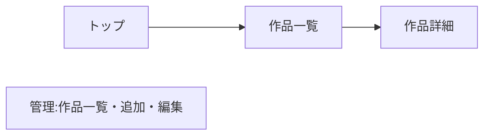

# 設計書 ― ものつくり 太郎さんのポートフォリオサイト

> この設計書は、「何を、誰のために、なぜ作るのか」を記録するものです。生成AIへの指示書にもなります。
> **【自分で直す所】** 1〜3章と4.1の「【要確認】」は、授業の「ものつくり 太郎」の例をもとに仮で書いてあります。自分のクライアントに合わせて置きかえてください。5章・7章は要望 A 対応を反映済みです。

| 項目 | 記入欄 |
| --- | --- |
| デザイナー(あなた) | Tuvshinbayar Amartuvshin(学籍番号 02511096) |
| クライアント | ものつくり 太郎(【自分のクライアントの名前に置きかえ】) |
| リポジトリ | 【GitHub のリポジトリ名】(Private) |
| 最終更新日 | 2026-11-25 |

---

## 1. ヒアリング記録(第2回)

### 1.1 基本情報

| 質問 | 回答 |
| --- | --- |
| 希望する業界・職種 | 電子機器メーカーの設計・試作職 |
| その業界を選んだ理由 | 自分が設計した装置が工場で動いているところを見たいから |
| 自分の強みだと思うこと(3つまで) | 手を動かして形にするまでやめない/回路とケースを1人で設計できる/後輩にはんだ付けを教えられる |
| 周りからよく言われる長所 | 手を動かして形にするまでやめない |
| 載せたい作品(作品名と、見てほしい点) | 温度ロガー(ケースまで自分で設計し、3回作り直した過程)/ライントレースロボット/学園祭ポスター/自己紹介ページ |
| 載せたくないこと・見せ方で避けたいこと | 派手さ、軽い印象 |

### 1.2 公開範囲とAIに渡してよい情報

| 情報 | サイトに載せてよい | AIに渡してよい |
| --- | --- | --- |
| 氏名 | ☑ | ☑ |
| 顔写真 | ☐ | ☐ |
| 連絡先 | ☐ | ☐ |
| 作品の画像 | ☑ | ☑ |
| その他(出身:埼玉県) | ☑ | ☑ |

### 1.3 ヒアリングで気づいたこと

- 本人がまだ言葉にできていないが、話の中から見えてきた強み:失敗の原因を測って直すところ(温度ロガーで2度高く出た原因を突き止めた)
- 追加で確認したいこと:作品の写真の有無/一番最初に見てほしい作品

---

## 2. ステークホルダー像(第2回)

このサイトを見るのは、**クライアントが希望する業界の採用担当者**です。

| 項目 | 記入欄 | 根拠(調べた情報源、URLなど) |
| --- | --- | --- |
| 業界・企業の例 | 電子機器・計測機器メーカーの設計職の採用 | 【企業の採用ページのURLを書く】 |
| 採用担当者が知りたいこと(重要な順に3つ) | ①最後まで作りきったか ②何を担当したか ③使える道具・技術 | 【企業の求める人物像のURLを書く】 |
| 1人あたりにかけられる閲覧時間の想定 | 面接前に1〜2分 | 【自分の想定。根拠があれば書く】 |
| 閲覧環境(PC/スマートフォン) | PCが中心。スマートフォンでも崩れないこと | 【確認した資料】 |
| マイナスの印象を与えそうなこと | 雑さ、完成していない印象 | 【確認した資料】 |

---

## 3. 伝えたいこと(第2回)

### 3.1 一文のメッセージ

> 採用担当者に、この人は「図面どおりに、最後まで作りきる人」だと感じてもらう。

### 3.2 情報の優先順位

| 優先 | 伝える情報 | 2のどの項目に応えるか |
| --- | --- | --- |
| 1 | 作りきった過程(温度ロガー) | 採用担当者が知りたいこと① |
| 2 | 担当した範囲(回路、基板、ケース設計) | 知りたいこと② |
| 3 | 使った道具(ESP32、Fusion 360 など) | 知りたいこと③ |
| 載せない | 顔写真、連絡先 | 載せない理由:1.2で本人が載せないと決めた |

---

## 4. 情報構造と画面遷移(第2回)

### 4.1 画面一覧

| 画面 | 誰が使うか | 目的 | 主な表示内容 |
| --- | --- | --- | --- |
| トップ | 採用担当者 | 一文のメッセージを5秒で伝える | 一文、作品の抜粋、できること、プロフィール |
| 作品一覧 | 採用担当者 | 作品を比べて選ぶ | 作品カード(画像、作品名、制作時期/道具)。**「先頭に出す」が付いた作品を先頭に置き、「先頭の作品」の文字を添える(要望 A)** |
| 作品詳細 | 採用担当者 | 作りきった過程を読む | 作品名、画像、制作時期、道具、担当、何を作ったか、工夫した点 |
| 管理:作品一覧 | クライアント | 登録した作品の確認・編集・削除 | 作品名と制作時期、編集・削除ボタン。**「先頭に出す」の作品には文字で印を出す(要望 A)** |
| 管理:作品の追加・編集 | クライアント | 作品を入力・変更する | 入力フォーム、エラー表示、**「作品一覧の先頭に出す」チェック(要望 A)** |

### 4.2 画面遷移

※ 手描きワイヤーフレームの写真/Figma リンク:【自分のものを貼る】

---

## 5. データ構造とAPI仕様(第5回)

### 5.1 作品データ

| 項目名 | 型 | 必須 | 説明 | 入力の制約(文字数など) |
| --- | --- | --- | --- | --- |
| id | 数値 | ○ | 作品を識別する番号 | 自動で付与(最大の id + 1) |
| title | 文字列 | ○ | 作品名 | 40文字まで |
| year | 文字列 | ○ | 制作時期 | 例:2026年 春 |
| summary | 文字列 | ○ | 一覧に出す一言 | 80文字まで |
| tools | 文字列 | | 使った道具・技術 | 100文字まで |
| role | 文字列 | | 担当 | 60文字まで |
| what | 文字列 | | 何を作ったか | 400文字まで |
| point | 文字列 | | 工夫した点 | 400文字まで |
| image | 文字列 | | 画像のファイル名 | 空なら images/placeholder.svg |
| alt | 文字列 | | 画像の代替テキスト | |
| **featured** | **真偽値** | | **作品一覧の先頭に出す(要望 A)** | **true にできるのは全作品で1件だけ。項目が無い作品は false として扱う。送られてきた値が true(真偽値)のときだけ true** |

### 5.2 API

| メソッド | パス | 目的 | 送るデータ | 返るデータ | 主なステータスコード |
| --- | --- | --- | --- | --- | --- |
| GET | /api/works | 作品一覧を取得 | なし | 作品の配列(featured を含む。並べかえは公開画面の main.js が行う) | 200 |
| GET | /api/works/:id | 作品を1件取得 | なし | 作品1件 | 200、404 |
| POST | /api/works | 作品を追加 | 5.1 の項目(id 以外) | 追加した作品 | 201、400(入力の誤り) |
| PUT | /api/works/:id | 作品を書きかえ | 5.1 の項目(id 以外) | 書きかえた作品 | 200、400、404 |
| DELETE | /api/works/:id | 作品を削除 | なし | なし | 204、404 |

**要望 A のきまり:** POST・PUT で featured が true の作品を保存したとき、サーバはほかのすべての作品の featured を false にする(先頭に出せるのは1件だけ)。

**注意:** 管理画面にはログインが無い。誰でも追加・編集・削除できるので、localhost で動かす間だけ使い、インターネットには公開しない。

### 5.3 エラーのときにユーザーへどう伝えるか(第6回)

| 起こりうる失敗 | 誰に表示されるか | 表示する文言 | 次にとれる行動 |
| --- | --- | --- | --- |
| 作品名が空 | クライアント | 作品名を入れてください | 作品名を入れて、もう一度保存する |
| 作品名が41文字以上 | クライアント | 作品名は40文字までにしてください | 短くして保存する |
| 制作時期が空 | クライアント | 制作時期を入れてください(例:2026年 春) | 入れて保存する |
| 一言が空 | クライアント | 一覧に出す一言を入れてください | 入れて保存する |
| 一言が81文字以上 | クライアント | 一言は80文字までにしてください | 短くして保存する |
| 道具が101文字以上 | クライアント | 使った道具は100文字までにしてください | 短くして保存する |
| 担当が61文字以上 | クライアント | 担当は60文字までにしてください | 短くして保存する |
| 何を作ったか/工夫した点が401文字以上 | クライアント | 「何を作ったか」(「工夫した点」)は400文字までにしてください | 短くして保存する |
| 編集・削除しようとした作品がもう無い | クライアント | その作品はすでに削除されています。 | 一覧を読み直す |
| サーバにつながらない(管理画面) | クライアント | サーバにつながりません。入力した内容は消えていません。サーバが起動しているか確かめて、もう一度押してください。 | サーバを起動して、もう一度押す |
| サーバにつながらない(公開画面) | 採用担当者 | 【自分の文言を書く。例:作品を読み込めませんでした。時間をおいて開き直してください。】 | 開き直す |

---

## 6. 確認すること(ユーザーテストの計画)

| テスト | 実施回 | 誰がどの役で | 確かめること | 成功の目安 |
| --- | --- | --- | --- | --- |
| 5秒テスト | 第3回 | 採用担当者役 | 3.1のメッセージが伝わるか | 5秒見た印象が、3.1に近い言葉で返ってくる |
| 公開画面のテスト | 第4回 | 採用担当者役 | 優先1〜3の情報に、迷わずたどり着けるか | 【自分で書く。例:30秒以内に温度ロガーの詳細を開ける】 |
| 管理画面のテスト | 第6回 | クライアント本人 | 作品の追加・編集を、説明なしでできるか | 説明なしで、追加と「先頭に出す」の付け外しができる |

テストの結果は、GitHub の Issue に1件ずつ記録する。

---

## 7. 変更履歴

| 日付 | 何を変えたか | きっかけ(Issue番号) | 理由 | 対応したコミット |
| --- | --- | --- | --- | --- |
| 【日付】 | 5.1 に featured(真偽値)を追加。5.2 に「先頭に出せるのは1件だけ」のきまりを追加。4.1 の作品一覧・管理画面の表示内容を追加。B 5章に「先頭の作品」のカードを追加 | クライアントの要望 A(温度ロガーを最初に見てほしい) | 面接前に一番見てほしい作品が、作った順で後ろに行ってしまうため | 要望 A 対応:設計書に先頭表示を追加 |
| 【日付】 | featured のチェック・並べかえ・表示を実装(server.js、admin.html、admin.js、main.js、style.css) | 要望 A | 同上 | 要望 A 対応:作品を先頭に出せるようにした |
| 【日付】 | 【テスト①の Issue で直したことを書く】 | #【番号】 | 【理由】 | 【コミット】 |
| 【日付】 | 【テスト②の Issue で直したことを書く】 | #【番号】 | 【理由】 | 【コミット】 |
